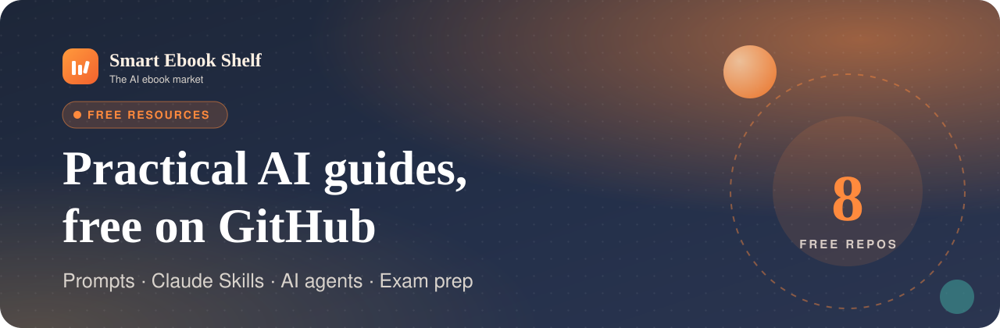

# Hi, I'm Smart Ebook Shelf 👋

I make **practical AI guides** for creators, freelancers, teachers and students: copy-paste prompts, ready-to-install Claude Skills, no-code AI agents and exam prep. Made by a software engineer who builds with AI every day.

## 🎁 Free resources on GitHub

| Repo | What you get |
|---|---|
| **[free-claude-skills](https://github.com/smartebookshelf/free-claude-skills)** | 3 ready-to-install Claude Skills: viral hooks, email replies, client proposals |
| **[aws-cloud-practitioner-practice-questions](https://github.com/smartebookshelf/aws-cloud-practitioner-practice-questions)** | 30 CLF-C02 practice questions with answers + cheat sheet |
| **[ai-video-prompts](https://github.com/smartebookshelf/ai-video-prompts)** | 30 AI video prompts for Veo, Sora, Kling and Runway |
| **[chatgpt-prompts-for-freelancers](https://github.com/smartebookshelf/chatgpt-prompts-for-freelancers)** | 20 prompts to win clients and deliver faster |
| **[ai-prompts-for-teachers](https://github.com/smartebookshelf/ai-prompts-for-teachers)** | 20 prompts for lessons, quizzes, rubrics and feedback |
| **[chatgpt-prompts-to-make-money](https://github.com/smartebookshelf/chatgpt-prompts-to-make-money)** | 20 prompts to start an honest side income |
| **[no-code-ai-agent-templates](https://github.com/smartebookshelf/no-code-ai-agent-templates)** | 2 copy-paste AI agents: Inbox and Research Assistant |
| **[which-ai-model-should-i-use](https://github.com/smartebookshelf/which-ai-model-should-i-use)** | Pick the right AI for each task |

## 📚 The full books

| Book | For |
|---|---|
| **[The Claude Skills Vault](https://bestbookdotcom.gumroad.com/l/claude-skills-vault)** | 30 ready-to-install Claude Skills + 58-page guide |
| **[AI Agents That Work While You Sleep](https://bestbookdotcom.gumroad.com/l/ai-agents-playbook)** | Build 8 no-code AI agents + 100 agent prompts |
| **[Prompts That Ship](https://bestbookdotcom.gumroad.com/l/ai-side-income-playbook)** | 300 production-grade ChatGPT, Claude & Gemini prompts |
| **[The Prompt Paycheck](https://bestbookdotcom.gumroad.com/l/prompt-paycheck)** | 300 prompts to make money online + 30-day plan |
| **[The AI Video Vault](https://bestbookdotcom.gumroad.com/l/ai-video-vault)** | 1,200+ AI video prompts, 40 AI hosts, 61 viral scripts |
| **[200 AI Prompts for Teachers](https://bestbookdotcom.gumroad.com/l/ai-prompts-for-teachers)** | Lesson plans, quizzes and feedback in minutes |
| **[Pass AWS Cloud Practitioner in 30 Days](https://bestbookdotcom.gumroad.com/l/aws-cloud-practitioner-study-guide-clf-c02)** | 30-day plan + 300 practice questions (CLF-C02) |
| **[Which AI Model Should You Actually Use?](https://bestbookdotcom.gumroad.com/l/ai-model-field-guide)** | Illustrated field guide to choosing AI tools |

**Free PDFs:** [15 Money-Making AI Prompts](https://bestbookdotcom.gumroad.com/l/free-money-making-ai-prompts) · [10 Free AI Video Prompts](https://bestbookdotcom.gumroad.com/l/free-ai-video-prompts) · [The AI Model Cheat Sheet](https://bestbookdotcom.gumroad.com/l/ai-model-cheat-sheet)

👉 **All books: [bestbookdotcom.gumroad.com](https://bestbookdotcom.gumroad.com/)**

---

⭐ If a repo helps you, a star helps other people find it.
